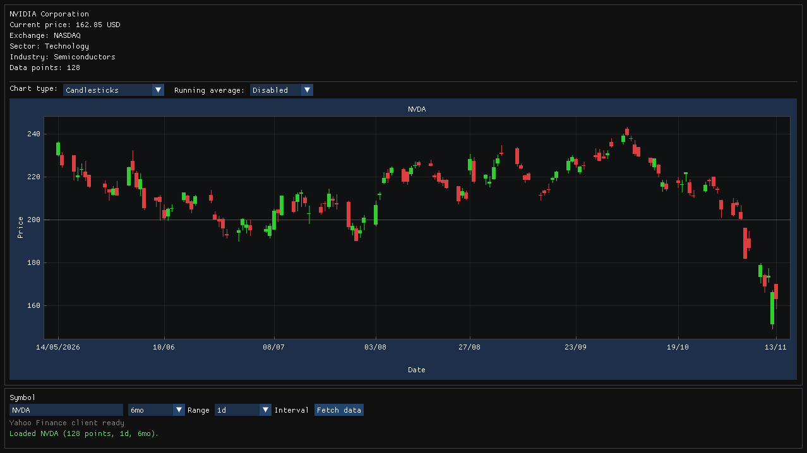

# Market Analyzer

A C project for a stock market analyzer using [Dear ImGui](https://github.com/ocornut/imgui) through [cimgui](https://github.com/cimgui/cimgui), with GLFW/OpenGL for rendering and [ImPlot](https://github.com/epezent/implot) for charting.

Stock price data is fetched using the Yahoo Finance chart API.

## Showcase


## Features
- Candlestick/line chart rendering
- Reusable Yahoo Finance C interface (`src/yfinance/`)

## Dependencies
Fetched/built by CMake where configured:
- GLFW
- Dear ImGui (docking)
- cimgui
- ImPlot

System dependencies:
- OpenGL
- libcurl
- json-c
- pkg-config

## Build
```bash
cmake -S . -B build
cmake --build build -j4
```

## Run
```bash
./build/market-analyzer
```
